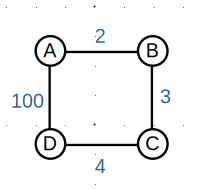
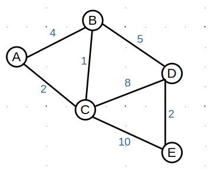
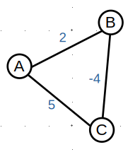

# Lab 08: Navigating Weighted Graphs with Dijkstra's Algorithm

Name(s): Abishek Dhakal  

## Introduction
You are already familiar with Breadth-First Search (BFS) and Depth-First Search (DFS) for exploring graphs. However, what happens when all edges are not created equal? In this lab, we will explore Dijkstra's Algorithm, which allows us to find the shortest path between two vertices in a *weighted* graph.

---

## Part 1: BFS with Weights

BFS is excellent for finding the shortest path in an unweighted graph. Let's see why it fails when weights are introduced. Consider the following weighted graph:

**Questions:**
1. If you run a standard BFS starting at Node $A$, looking for Node $D$, which path will the BFS algorithm discover first? Why?
   > BFS will discover the path $A \rightarrow D$ first. BFS looks for the path with the fewest edges before considering longer routes. The direct edge from $A$ to $D$ has length 1, while the alternative route $A \rightarrow B \rightarrow C \rightarrow D$ has length 3.

2. What is the total weight of the path BFS found? What is the total weight of the alternative path? 
   > The path BFS finds first is $A \rightarrow D$, with total weight $100$. The alternative path is $A \rightarrow B \rightarrow C \rightarrow D$, with total weight $2 + 3 + 4 = 9$.

3. How does the definition of "shortest path" change when moving from unweighted graphs to weighted graphs?
   > In an unweighted graph, "shortest" means the fewest number of edges. In a weighted graph, "shortest" means the minimum total sum of edge weights, even if that path uses more edges than a lighter path with fewer edges would.

---

## Part 2: Dijkstra's Algorithm

Dijkstra's algorithm uses a greedy approach. It maintains a set of "visited" (finalized) nodes and an array of the shortest known distances to all other nodes. Consider the following weighted graph:

**Instructions:**
Starting at Node $A$, trace Dijkstra's algorithm. Fill in the tracker table below. 
*   **Current Node:** The unvisited node with the smallest current distance.
*   **Neighbors to Check:** The neighbors of the current node whose distances might need updating.
*   **`dist` Array:** The current known shortest distance from $A$ to each node. Use $\infty$ for unreachable/unknown nodes.
*   **`visited` Set:** The set of nodes that have been finalized and whose shortest distances are known.

| Step | Current Node | Neighbors to Check | `dist` Map | `visited` Set | 
| :--- | :--- | :--- | :--- | :--- | 
| 0 | $A$ | $B$, $C$ | $A$:0, $B$:4, $C$:2, $D$: $\infty$, $E$: $\infty$ | { } | 
| 1 | $C$ | $B$, $D$, $E$ | $A$:0, $B$:3, $C$:2, $D$:10, $E$:4 | { $A$ } | 
| 2 | $B$ | $D$ | $A$:0, $B$:3, $C$:2, $D$:8, $E$:4 | { $A$, $C$ } | 
| 3 | $E$ | $D$ | $A$:0, $B$:3, $C$:2, $D$:8, $E$:4 | { $A$, $C$, $B$ } | 
| 4 | $D$ | none | $A$:0, $B$:3, $C$:2, $D$:8, $E$:4 | { $A$, $C$, $B$, $E$ } |

**Conceptual Question:**
When we add a vertex to the "visited" set, why are we 100% certain we have found the absolute shortest path to that node? 
> Because all edge weights are nonnegative, the next unvisited vertex chosen by Dijkstra has the smallest tentative distance. Any path from $A$ to that vertex through another unvisited node would have to pass through a node with a distance at least as large as this one, and adding nonnegative edges cannot make a route cheaper. Therefore, no future path can improve the distance to that node, so it is finalized.

---

## Part 3: Assumptions

Dijkstra's algorithm relies on an assumption about the weights. Let's see what happens when we break it. Consider the following weighted graph, which contains a negative edge:

**Corrected graph:** The directed edges are $A \rightarrow B$ with weight $2$, $B \rightarrow C$ with weight $-5$, and $C \rightarrow A$ with weight $1$.

**Instructions:**
Trace Dijkstra's algorithm starting from Node $A$ to find the shortest path to Node $C$.

1. Which node does Dijkstra's algorithm visit first after $A$?
   > After $A$, Dijkstra visits $B$ first because its tentative distance is $2$. The distance to $C$ is still $\infty$, since there is no direct edge from $A$ to $C$ in the corrected graph.

2. What will Dijkstra's algorithm declare as the shortest path to $C$, and what is its weight?
   > Dijkstra declares the path $A \rightarrow B \rightarrow C$, with weight $2 + (-5) = -3$.

3. Look at the graph manually. What is the *actual* shortest path from $A$ to $C$, and what is its total weight? 
   > There is no finite shortest path because the reachable cycle $A \rightarrow B \rightarrow C \rightarrow A$ has weight $2 + (-5) + 1 = -2$. Each repetition reduces the total cost by $2$.

4. **The Trap:** Explain exactly *why* Dijkstra's algorithm failed to find the correct shortest path in this scenario.
   > Dijkstra finalizes $A$ at distance $0$, then $B$ at $2$, and $C$ at $-3$. However, the edge $C \rightarrow A$ offers a distance of $-3 + 1 = -2$ to the already finalized node $A$. This breaks the assumption that a finalized distance cannot improve. Repeating the negative cycle keeps lowering the cost, so Dijkstra's finite answer is incorrect.

---

## Part 4: Implementing Dijkstra's Algorithm

In the real world, problems rarely look like neat mathematical graphs right away. You often have to translate real-world constraints into a standard graph format so that an algorithm like Dijkstra's can process it.

**The Scenario:**
You are building a navigation app for delivery robots on a college campus. 

* Moving between any two adjacent sidewalk intersections takes exactly $2$ minutes.

* Some paths have stairs. The robots *cannot* use stairs.

* Certain intersections are busy crosswalks. The robot must wait an additional $3$ minutes at these specific intersections before it can safely leave them and continue on its path.

**The Problem:**
Standard Dijkstra's algorithm only understands *edges* and *edge weights*. It does not natively understand "node weights" (like waiting at an intersection) or "impassable terrain".

**Questions:**

1. How should you represent the paths with stairs in your graph so the algorithm never tries to use them?

   > Do not include the stair edges in the graph at all. If a path between two intersections requires stairs, simply omit that edge, so Dijkstra never even considers it.

2. How can you account for the $3$-minute waiting time at busy crosswalk intersections using *only* edge weights? (Hint: Think about how you could modify the weights of edges connecting to that intersection).

   > Add the extra $3$ minutes to the weight of every edge that leaves a busy crosswalk intersection. For example, if an ordinary sidewalk normally costs $2$ minutes, then a robot leaving a busy intersection on that segment would use a cost of $2 + 3 = 5$ minutes. This turns the waiting time into a regular edge weight that Dijkstra can handle.
